# Architecture Overview

This document describes the frontend architecture for TrustLink, documenting actual modules, routes, provider mounting structure, data access paths, and legacy boundaries alongside planned consolidations.

Related guides: [Payment mock flags & funding boundaries](docs/PAYMENT_BOUNDARIES.md), [API endpoint matrix](docs/API_MATRIX.md), [Environment variables](docs/ENV_VARS.md).

---

## Component & Module Tree

The following diagram reflects the concrete files and modules present in the repository, distinguishing current parallel access paths from planned consolidations.

```mermaid
flowchart TD
    %% ── App Router (app/) ──
    subgraph APP["app/ (App Router)"]
        A_LAYOUT["layout.tsx<br/>Root Layout & Provider Hierarchy"]
        A_PAGE["page.tsx<br/>Landing Page"]
        A_DASH["dashboard/page.tsx<br/>Vendor Dashboard"]
        A_PAY["pay/[escrowId]/page.tsx<br/>Buyer Payment (Server Component)"]
        A_TRACK["track/[escrowId]/page.tsx<br/>Order Tracking"]
        A_ADMIN["admin/disputes/page.tsx<br/>Admin Dispute Queue"]
        A_ADMIN_ID["admin/disputes/[id]/page.tsx<br/>Admin Dispute Detail & Resolution"]
        A_DISPUTE["dispute/[id]/page.tsx<br/>Raise a Dispute"]
        A_ONBOARD["onboarding/page.tsx<br/>Vendor Onboarding"]
        A_NOTIF["notifications/page.tsx<br/>Notifications View"]
        A_NOTIF_SET["settings/notifications/page.tsx<br/>Notification Preferences"]
        A_PROFILE["profile/page.tsx<br/>Profile"]
        A_PROFILE_SET["settings/profile/page.tsx<br/>Profile Settings"]
        A_ANALYTICS["analytics/page.tsx<br/>Analytics"]
        A_CREATE["create/page.tsx<br/>Escrow Creation"]
        A_OG["api/og/route.tsx<br/>OG Image Generation"]
        A_ESC_ROUTE["escrow/route.ts<br/>Local API Proxy (GET, POST)"]
        A_SHIP_ROUTE["escrow/[id]/ship/route.ts<br/>Local Mock Ship Handler"]
    end

    %% ── Provider Hierarchy (mounted in layout.tsx) ──
    subgraph PROV["components/providers/ (Provider Hierarchy)"]
        P_THEME["ThemeProvider<br/>next-themes dark/light"]
        P_NET["NetworkProvider<br/>Mainnet/Testnet context"]
        P_SW["ServiceWorkerProvider<br/>Offline PWA support"]
        B_OFFLINE["OfflineBanner<br/>components/layout/OfflineBanner.tsx"]
        B_TESTNET["TestnetBanner<br/>components/layout/TestnetBanner.tsx"]
        P_WALLET["WalletProvider<br/>Freighter + SEP-10 Auth Context"]
        P_SUB["SubscriptionProvider<br/>FREE/PRO plan + 5m cache"]
        P_CURR["CurrencyProvider<br/>Currency selection & formatting"]
        P_I18N["I18nProvider<br/>react-i18next context"]
        P_NOTIF["NotificationProvider<br/>Polling (30s) + read state"]
    end

    %% ── UI & Domain Components ──
    subgraph COMP["components/"]
        C_ESCROW["components/escrow/<br/>EscrowCreateForm, EscrowLinkCard, DisputeForm"]
        C_TRACK["components/tracking/<br/>TrackingTimeline, TrackingSection, TrackingLookupForm"]
        C_DASH["components/dashboard/<br/>VendorDashboardList, EscrowTableRow, VendorAnalyticsSection, ShipTrackingModal"]
        C_PAY["components/payment/<br/>PaymentSection, PaymentForm, TrustBadge, EscrowCountdown"]
        C_NOTIF["components/notifications/<br/>NotificationBell, NotificationsPageContent"]
        C_ONBOARD["components/onboarding/<br/>VendorOnboardingWizard (3-step)"]
        C_SUB["components/subscription/<br/>ProGate, UpgradeCTA"]
        C_WALLET["components/wallet/<br/>WalletConnectButton"]
        C_LAYOUT["components/layout/<br/>Navbar, Footer, BottomNav, TestnetBanner, OfflineBanner"]
        C_UI["components/ui/<br/>shadcn/ui primitives, CommandPalette, Toaster"]
    end

    %% ── Hooks ──
    subgraph HOOKS["hooks/ & Provider Hooks"]
        HK_WALLET["hooks/useWallet.ts<br/>Context consumer for WalletProvider"]
        HK_ESCROW["hooks/useEscrow.ts<br/>Vendor escrows and creation"]
        HK_TRACK["hooks/useTracking.ts<br/>Escrow tracking details"]
        HK_NET["hooks/useNetwork.ts<br/>Re-export from NetworkProvider"]
        HK_TOAST["hooks/useToast.ts<br/>Toast feedback"]
        HK_NOTIF["useNotifications<br/>Exported from NotificationProvider.tsx"]
        HK_SUB["useSubscription<br/>Exported from SubscriptionProvider.tsx"]
        HK_CURR["useCurrency<br/>Exported from CurrencyProvider.tsx"]
        HK_LEGACY_WALLET["hooks/useStellarWallet.ts<br/>(Legacy / Parallel Wallet Hook)"]
    end

    %% ── Data & Utility Layer ──
    subgraph LIB["lib/ & utils/"]
        L_CANONICAL["lib/api/client.ts<br/>Canonical API Client (request helper)"]
        L_BARREL["lib/api.ts<br/>API Barrel re-exports"]
        L_AUTH_STELLAR["lib/stellar.ts<br/>Direct fetch: /auth/challenge & verify"]
        L_CONTRACT["lib/stellar/contract.ts<br/>Soroban contract invocations"]
        L_POLL["lib/stellar/poll.ts<br/>pollWithBackoff for tx confirmation"]
        L_FREIGHTER["lib/stellar/freighter.ts<br/>Freighter browser API wrapper"]
        L_NETWORKS["lib/stellar/networks.ts<br/>Passphrase and RPC config"]
        L_NOTIF["lib/notifications.ts<br/>deriveNotifications, localStorage read IDs"]
        L_STORE["lib/escrowStore.ts<br/>In-memory mock store (for local mock route)"]
        L_SESSION["lib/session.ts<br/>SESSION_KEY, refresh schedules, expiry events"]
        L_RATELIMIT["lib/rateLimit.ts<br/>Upstash Redis & in-memory limiter"]
        L_EXPLORER["lib/explorer.ts<br/>Stellar Expert link generator"]
        U_CURRENCY["utils/currency.ts<br/>formatUSDC, formatCurrency"]
    end

    %% ── Types Layer ──
    subgraph TYPES["types/"]
        T_INDEX["types/index.ts<br/>Domain types: Escrow, Dispute, SubscriptionTier"]
        T_API["types/api.ts<br/>API Request/Response interfaces"]
        T_STELLAR["types/stellar.ts<br/>Network and Stellar account types"]
        T_GUARDS["types/guards.ts<br/>Runtime response shape guards"]
        T_STATUS["types/status.ts<br/>Escrow & Dispute status constants"]
    end

    %% ── Mounting & Tree Connections ──
    A_LAYOUT --> P_THEME
    P_THEME --> P_NET
    P_NET --> P_SW
    P_NET --> B_OFFLINE
    P_NET --> B_TESTNET
    P_NET --> P_WALLET
    P_WALLET --> P_SUB
    P_SUB --> P_CURR
    P_CURR --> P_I18N
    P_I18N --> P_NOTIF
    P_NOTIF --> C_LAYOUT
    P_THEME --> C_UI

    %% ── Page rendering components ──
    A_DASH --> C_DASH
    A_PAY --> C_PAY
    A_TRACK --> C_TRACK
    A_ADMIN --> C_ESCROW
    A_ADMIN_ID --> C_ESCROW
    A_DISPUTE --> C_ESCROW
    A_ONBOARD --> C_ONBOARD
    A_NOTIF --> C_NOTIF
    A_NOTIF_SET --> C_NOTIF
    A_CREATE --> C_ESCROW
    A_CREATE --> C_WALLET

    %% ── Hook to Provider relationships ──
    HK_WALLET --> P_WALLET
    HK_SUB --> P_SUB
    HK_NOTIF --> P_NOTIF
    HK_CURR --> P_CURR
    HK_NET --> P_NET

    %% ── Component to Hook connections ──
    C_DASH --> HK_ESCROW
    C_DASH --> HK_WALLET
    C_PAY --> HK_WALLET
    C_PAY --> U_CURRENCY
    C_NOTIF --> HK_NOTIF
    C_SUB --> HK_SUB
    C_ESCROW --> HK_ESCROW

    %% ── Data Access Connections ──
    HK_ESCROW --> L_BARREL
    HK_TRACK --> L_BARREL
    P_NOTIF -.->|polls 30s| L_BARREL
    P_NOTIF -.->|derives| L_NOTIF
    P_SUB -.->|caches 5m| L_BARREL
    L_BARREL --> L_CANONICAL
    L_CANONICAL --> L_SESSION
    L_CANONICAL --> T_API
    L_CANONICAL --> T_GUARDS

    %% ── Stellar & Wallet wiring ──
    P_WALLET --> L_AUTH_STELLAR
    P_WALLET --> L_FREIGHTER
    P_WALLET --> L_SESSION
    C_PAY --> L_CONTRACT
    L_CONTRACT --> L_NETWORKS
    L_CONTRACT --> L_FREIGHTER
    L_CONTRACT --> L_POLL

    %% ── Legacy & Parallel Boundaries (Dotted) ──
    HK_LEGACY_WALLET -.->|uncoordinated parallel lifecycle| L_AUTH_STELLAR
    A_SHIP_ROUTE -.->|in-memory local store| L_STORE
    A_ESC_ROUTE -.->|server proxy| L_BARREL
```



---

## Route Map (`app/`)

Every `page.tsx` and route handler currently in `app/`. Page components are thin: most render a client component from `components/` or a sibling `*Client.tsx` file inside a `<Suspense>` or error boundary.

### Pages

| Route | File | Purpose |
|---|---|---|
| `/` | `app/page.tsx` | Landing page |
| `/create` | `app/create/page.tsx` | Vendor creates an escrow link (`EscrowCreateForm`, wallet connect) |
| `/dashboard` | `app/dashboard/page.tsx` | Vendor dashboard (`DashboardClient`) |
| `/dashboard/analytics` | `app/dashboard/analytics/page.tsx` | Vendor analytics (`VendorAnalyticsSection`) |
| `/vendor/analytics` | `app/vendor/analytics/page.tsx` | Second route to the same `VendorAnalyticsSection` |
| `/analytics` | `app/analytics/page.tsx` | Analytics view (`AnalyticsClient`) |
| `/vendor/[id]` | `app/vendor/[id]/page.tsx` | Public vendor profile; metadata generated per vendor |
| `/onboarding` | `app/onboarding/page.tsx` | Vendor onboarding wizard |
| `/profile` | `app/profile/page.tsx` | Signed-in user profile (`ProfileClient`) |
| `/settings/profile` | `app/settings/profile/page.tsx` | Profile settings (`ProfileSettingsClient`) |
| `/settings/notifications` | `app/settings/notifications/page.tsx` | Notification preferences |
| `/notifications` | `app/notifications/page.tsx` | Notification list (`NotificationsPageContent`) |
| `/pay/[escrowId]` | `app/pay/[escrowId]/page.tsx` | Buyer payment. Async Server Component that fetches the escrow for metadata, then renders `PaymentEscrowClient` |
| `/payment` | `app/payment/page.tsx` | Payment page built on `PaymentSection` |
| `/track/[escrowId]` | `app/track/[escrowId]/page.tsx` | Order tracking timeline for one escrow |
| `/tracking` | `app/tracking/page.tsx` | Tracking lookup form |
| `/dispute/[id]` | `app/dispute/[id]/page.tsx` | Buyer or vendor raises a dispute |
| `/admin/disputes` | `app/admin/disputes/page.tsx` | Admin queue of open disputes |
| `/admin/disputes/[id]` | `app/admin/disputes/[id]/page.tsx` | Admin dispute detail and resolution (`DisputeDetailsClient`) |
| `/pricing` | `app/pricing/page.tsx` | FREE / PRO plans |
| `/about`, `/contact`, `/docs` | `app/about`, `app/contact`, `app/docs` | Static information pages |
| `/offline` | `app/offline/page.tsx` | Fallback page served by the service worker |
| `/badge-visual-test`, `/dispute-form-test` | `app/badge-visual-test`, `app/dispute-form-test` | Fixture pages for visual and form tests, not product screens |

Other files in `app/`: `layout.tsx` (root layout), `template.tsx`, `error.tsx`, `global-error.tsx`, `not-found.tsx`, `manifest.ts`, `robots.ts` and `sitemap.ts`.

### Route handlers

| Route | File | Purpose |
|---|---|---|
| `GET`/`POST` `/escrow` | `app/escrow/route.ts` | Rate-limited, Zod-validated proxy to the backend (see Data Access Paths) |
| `POST` `/escrow/[id]/ship` | `app/escrow/[id]/ship/route.ts` | Local mock ship handler on the in-memory store |
| `GET` `/api/og` | `app/api/og/route.tsx` | Open Graph image generation |

---

## Provider Mounting Hierarchy (`app/layout.tsx`)

The root layout (`app/layout.tsx`) mounts seven context providers (`ThemeProvider`, `NetworkProvider`, `WalletProvider`, `SubscriptionProvider`, `CurrencyProvider`, `I18nProvider`, `NotificationProvider`) plus `ServiceWorkerProvider`, which renders nothing and only registers the service worker. `OfflineBanner` and `TestnetBanner` are plain components that sit beside the providers inside `NetworkProvider`; they are not providers. The providers nest in a specific order so dependencies are initialized in sequence (network selection is needed by the wallet, and wallet authentication is needed by subscription and notifications):

```
ThemeProvider
  ├── Suspense → TopProgressBar (route-change progress bar)
  ├── NetworkProvider
  │     ├── ServiceWorkerProvider (sibling, registered for PWA / offline support)
  │     ├── OfflineBanner (sibling, shown only while offline)
  │     ├── TestnetBanner (sibling, shown only on testnet)
  │     ├── "Skip to content" link (targets <main id="main-content">)
  │     └── WalletProvider
  │           └── SubscriptionProvider
  │                 └── CurrencyProvider
  │                       └── I18nProvider
  │                             └── NotificationProvider
  │                                   ├── Navbar
  │                                   ├── <main id="main-content">{children}</main>
  │                                   ├── Footer
  │                                   ├── BottomNav
  │                                   └── Toaster (Sonner)
  └── CommandPalette (mounted under ThemeProvider, outside NetworkProvider)
```

### Provider Access Patterns & Real Exports

Provider contexts are consumed via dedicated hooks. In several cases, the hook is exported directly from the provider file rather than a standalone file in `hooks/`:

| Provider | Exporting Module | Hook Import | Owns |
|---|---|---|---|
| `WalletProvider` | `components/providers/WalletProvider.tsx` | `useWallet` from `@/hooks/useWallet` | Freighter extension connection, SEP-10 challenge-response auth, JWT persistence, session expiry listener (`SESSION_EXPIRED_EVENT`), `signTransaction` |
| `NotificationProvider` | `components/providers/NotificationProvider.tsx` | `useNotifications` from `@/components/providers/NotificationProvider` | 30s background polling of `getVendorEscrows`, deriving notifications (`lib/notifications.ts`), `readIds` persistence in `localStorage`, unread counts |
| `SubscriptionProvider` | `components/providers/SubscriptionProvider.tsx` | `useSubscription` from `@/components/providers/SubscriptionProvider` | Subscription details (`getSubscription()`), 5-min caching in `localStorage` (`subscription.cache`), active tier (`FREE`/`PRO`), `isPro` flag |
| `CurrencyProvider` | `components/providers/CurrencyProvider.tsx` | `useCurrency` from `@/components/providers/CurrencyProvider` | Selected display currency, FX rates, and `formatAmount` formatting helper |
| `NetworkProvider` | `components/providers/NetworkProvider.tsx` | `useNetwork` from `@/components/providers/NetworkProvider` (or `@/hooks/useNetwork`) | Active Stellar network selection (`testnet` vs `mainnet`) and passphrases |
| `ServiceWorkerProvider` | `components/providers/ServiceWorkerProvider.tsx` | none (renders nothing) | Registers the service worker, shows an "Update available" toast with a Refresh action when a new version is installed |
| `ThemeProvider` | `components/providers/ThemeProvider.tsx` | `useTheme` from `next-themes` | Dark / light mode toggle with hydration-safe inline script |

---

## Where Things Live

Some modules are not where their names suggest: several hooks are exported from provider files, and domain types are consolidated rather than split per feature. Use this table to find them.

| Looking for | Actual location | Notes |
|---|---|---|
| Horizon / RPC configuration | `lib/stellar/networks.ts` and `components/providers/NetworkProvider.tsx` | There is no separate Horizon client module. RPC calls go through `@stellar/stellar-sdk` with the configured RPC URL. Explorer links are built by `lib/explorer.ts` |
| Escrow, dispute and subscription domain types | `types/index.ts` | `Escrow`, `Dispute`, `SubscriptionTier`, `AppNotification` and `NotificationFilter` are all here |
| API request and response types | `types/api.ts` | Subscription and notification-preference payloads also live here |
| Currency formatting (`formatUSDC`, `formatCurrency`) | `utils/currency.ts` | Imported as `@/utils/currency` |
| Tracking components (`TrackingTimeline`, `TrackingSection`, `TrackingLookupForm`) | `components/tracking/` | Used by `/track/[escrowId]` and `/tracking`. A second, smaller `TrackingTimeline` in `components/escrow/TrackingTimeline.tsx` is what the pay page lazy-loads, so check the import path before editing either one |
| `useNotifications` | `components/providers/NotificationProvider.tsx` | Exported alongside the provider |
| `useSubscription` | `components/providers/SubscriptionProvider.tsx` | Exported alongside the provider |
| `useCurrency` | `components/providers/CurrencyProvider.tsx` | Exported alongside the provider |
| Transaction confirmation polling | `lib/stellar/poll.ts` | `pollWithBackoff()` and `computeBackoffDelay()`, used by the contract helpers in `lib/stellar/contract.ts` |

---

## Data Access Paths: Current Behavior vs Desired Consolidation

TrustLink currently contains parallel data-access paths and legacy boundaries that are being consolidated in upcoming releases.

### 1. Wallet Lifecycle Architecture

```
Current Reality (Parallel implementations):
  [Components] ──> useWallet() ─────────> WalletProvider ──> Freighter / SEP-10 Auth (Session Sync)
  [Legacy Path] ─> useStellarWallet() ──> Local State ────> Freighter / SEP-10 Auth (No Context Sync)

Desired Consolidation (Backlog Issues #101, #102):
  [All Components] ──> useWallet() ──> WalletProvider ──> Centralized Session & Refresh
```

- **Current Behavior**:
  - `WalletProvider` (`components/providers/WalletProvider.tsx`) is the supported context provider. It stores the JWT in `localStorage` (`wallet.jwt` via `SESSION_KEY`), manages session refresh timers (`lib/session.ts`), listens for `SESSION_EXPIRED_EVENT`, and sets the logger user identity.
  - `useStellarWallet` (`hooks/useStellarWallet.ts`) is an uncoordinated parallel hook that implements its own independent state (`publicKey`, `token`) and writes to `wallet.token` instead of `wallet.jwt`. It does not share state across components or handle global expiry events.
- **Consolidation Target**: Unify all wallet consumers behind `WalletProvider` and `useWallet`, removing `useStellarWallet`.

### 2. HTTP Transport & API Client

```
Current Reality (Mixed transport layers):
  [Hooks / Components] ──> lib/api.ts (barrel) ──> lib/api/client.ts (Canonical Client)
  [Auth Helpers] ────────> lib/stellar.ts ─────────> Direct fetch() (/auth/challenge, /auth/verify)
  [Client Fetches] ──────> TrackingSection/Pricing ─> Direct fetch()
  [Local Next.js Routes] ─> app/escrow/route.ts ────> Proxies to lib/api
  [Local Mock Route] ────> app/escrow/[id]/ship ───> lib/escrowStore.ts (In-memory mock)

Desired Consolidation (Backlog Issue #106):
  [All Network Calls] ───> lib/api/client.ts ──────> Single HTTP Transport & Error Layer
```

- **Current Behavior**:
  - `lib/api/client.ts` is the canonical typed client. It implements the centralized `request<T>()` helper, attaches `Authorization: Bearer <token>`, catches network rejections via `ApiNetworkError`, parses structured error payloads with `ApiError`, triggers `handleSessionExpired()` on 401s, and validates responses against runtime type guards (`types/guards.ts`).
  - `lib/api.ts` is a barrel file re-exporting client functions and types for backwards compatibility.
  - `lib/stellar.ts` handles SEP-10 authentication (`getChallenge`, `verifyChallenge`) by calling `fetch` directly with custom error parsing rather than using `lib/api/client.ts`.
  - Certain client components (e.g. `components/tracking/TrackingSection.tsx`, `app/pricing/PricingClient.tsx`) issue direct `fetch` calls.
  - Next.js Route Handlers:
    - `app/escrow/route.ts`: Server-side proxy with rate limiting (`lib/rateLimit.ts`) and Zod validation, delegating to `lib/api`.
    - `app/escrow/[id]/ship/route.ts`: Local mock endpoint updating in-memory store `lib/escrowStore.ts`.
- **Consolidation Target**: Migrate `lib/stellar.ts` and direct page fetches onto `lib/api/client.ts` to share transport, retry, and auth refresh logic.
- **Detailed Matrix Reference**: For a comprehensive map of all 19 canonical client endpoints, auth helper functions, local route handlers, request/response payload types, and singular/plural fallback conventions, see [Frontend API Endpoint & Authentication Matrix](docs/API_MATRIX.md).

### 3. Server Components vs Client Pages

- Documentation previously stated all pages are thin wrappers composing domain components.
- In practice:
  - **Server Components with Data Fetching**: `app/pay/[escrowId]/page.tsx` is an async Server Component that executes `getEscrow(escrowId)` during server render (`generateMetadata`) to produce dynamic Open Graph metadata and title tags before streaming HTML.
  - **Dynamic Client Pages**: `app/dashboard/page.tsx` and `app/create/page.tsx` serve as lightweight entry points wrapping client-side state managers (`DashboardClient`, `EscrowCreateForm`) inside React `<Suspense>` boundaries.

---

## Escrow Lifecycle Flow

1. **Escrow Creation**: A vendor connects their wallet via `WalletProvider` (`useWallet`), inputs terms in `EscrowCreateForm`, and submits via `createEscrow()` (`POST /escrow`).
2. **Buyer Payment**:
   - The buyer accesses `app/pay/[escrowId]/page.tsx`. Server metadata loads the item title and amount.
   - The live page client, `PaymentEscrowClient` (`app/pay/[escrowId]/PaymentEscrowClient.tsx`), does not read the mock flags. `NEXT_PUBLIC_USE_MOCKS` is read only by the `PaymentForm` component and `NEXT_PUBLIC_ESCROW_MOCK_PAYMENTS` only by `submitPayment()`; no page currently uses either. For full documentation of flags, stages, and boundaries, see [Payment Mock Flags & Production Funding Boundaries](docs/PAYMENT_BOUNDARIES.md).
   - In production/testnet, `buildFundingTransactionXdr()` constructs the Soroban `fund_escrow` invocation, the buyer signs via Freighter (`signTransaction`), and `submitTransaction()` submits the signed XDR to the Soroban RPC, polling until ledger inclusion.
3. **Fulfillment & Shipping**:
   - The vendor opens `ShipTrackingModal` on the dashboard and submits tracking details via `shipEscrow()` (`POST /escrows/:id/ship`).
   - The buyer tracks package movement in `TrackingTimeline` (`GET /escrows/:id/tracking`).
4. **Delivery Confirmation / Funds Release**:
   - The buyer confirms receipt in `TrackingTimeline`, invoking `confirmDelivery()` (`POST /escrows/:id/confirm`) to release funds to the vendor.
5. **Dispute Handling**:
   - In case of a defect or non-delivery, either party submits `DisputeForm` via `createDispute()` (`POST /escrows/:id/dispute`).
   - Admins review active disputes in `app/admin/disputes/page.tsx` (`GET /disputes?status=OPEN,UNDER_REVIEW`) and execute resolutions via `resolveDispute()` (`PATCH /disputes/:id/resolve`).

---

## Further Reading

- [Soroban Contract Integration](docs/SOROBAN_CONTRACT_INTEGRATION.md): how the frontend builds, signs, submits and confirms contract transactions, including confirmation polling, timeouts and known gaps.
- [Payment Mock Flags & Production Funding Boundaries](docs/PAYMENT_BOUNDARIES.md): what mock flags change and what counts as real settlement.
