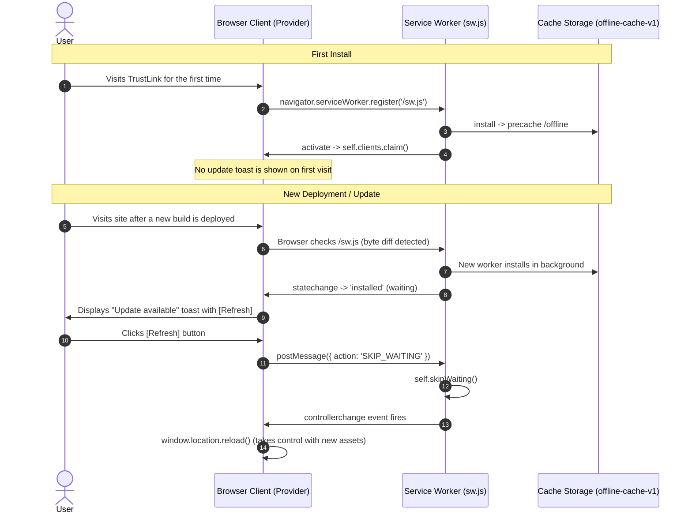

# Service Worker, Offline Fallback & Update Lifecycle

> **Summary**: TrustLink uses a lightweight service worker (`public/sw.js`) managed by `components/providers/ServiceWorkerProvider.tsx`. It provides an offline fallback page during network disconnections and coordinates seamless client updates when a new version of the application is deployed.

---

## Table of Contents

- [Cache Scope & Offline Capabilities](#cache-scope--offline-capabilities)
- [What Is NOT Cached (Network Prerequisites)](#what-is-not-cached-network-prerequisites)
- [Service Worker Architecture](#service-worker-architecture)
- [Lifecycle: First Install vs. Update](#lifecycle-first-install-vs-update)
  - [1. First Install](#1-first-install)
  - [2. Update & Controller Transfer](#2-update--controller-transfer)
- [Contributor Testing Procedures](#contributor-testing-procedures)
  - [Test 1: Verify Initial Registration & Precache](#test-1-verify-initial-registration--precache)
  - [Test 2: Verify Offline Navigation & Reconnect](#test-2-verify-offline-navigation--reconnect)
  - [Test 3: Verify Service Worker Update & Refresh Flow](#test-3-verify-service-worker-update--refresh-flow)
- [Troubleshooting & Local Cleanup](#troubleshooting--local-cleanup)
  - [Unregistering Only TrustLink's Worker (Chrome / Edge)](#unregistering-only-trustlinks-worker-chrome--edge)
  - [Unregistering in Firefox](#unregistering-in-firefox)
  - [Unregistering in Safari](#unregistering-in-safari)
  - [Clearing Only TrustLink's Cache Storage](#clearing-only-trustlinks-cache-storage)

---

## Cache Scope & Offline Capabilities

The TrustLink service worker is intentionally scoped to provide a **safe navigation fallback**, without aggressively caching dynamic application assets or API payloads:

- **Cached Route**: Exactly one resource is precached: `/offline` (`app/offline/OfflineClient.tsx`).
- **Cache Name**: `offline-cache-v1` (defined in `public/sw.js`).
- **Intercepted Requests**: Only navigation requests (`event.request.mode === 'navigate'`).

When a user loses internet connectivity and attempts to navigate to any URL or reload a page, the service worker catches the failed network fetch and serves the precached `/offline` HTML page displaying a friendly "You are offline" interface and a "Try Again" action button.

---

## What Is NOT Cached (Network Prerequisites)

To guarantee transaction accuracy and avoid stale financial states, the service worker does **not** cache or mock runtime financial or data operations:

1. **Static Assets & Code Chunks**: JavaScript bundles, CSS stylesheets, web fonts, and images are **not** cached in Cache Storage by the service worker. They rely solely on standard HTTP cache headers served by Next.js / CDN.
2. **API Requests**: All REST queries (`/api/*` routes and backend requests to `NEXT_PUBLIC_API_URL`) are bypassed by the fetch listener and require an active network connection.
3. **Smart Contract & Wallet Operations**: Soroban RPC calls (`NEXT_PUBLIC_SOROBAN_RPC_URL`), transaction building, cryptographic signing with Freighter, and escrow contract state checks strictly require real-time internet connectivity.
4. **Offline Payments**: **Offline payments or transaction queues are completely out of scope and not supported.** Escrow funding and release transactions must never be executed while offline.

---

## Service Worker Architecture

The implementation consists of two core files:

1. **`public/sw.js`** (Service Worker Script):
   - **`install` event**: Opens `offline-cache-v1` and precaches `/offline`.
   - **`activate` event**: Deletes any stale caches whose names do not match `offline-cache-v1`, and claims connected clients via `self.clients.claim()`.
   - **`message` event**: Listens for `{ action: 'SKIP_WAITING' }` messages from the client to call `self.skipWaiting()`.
   - **`fetch` event**: Intercepts `request.mode === 'navigate'`. Attempts `fetch(event.request)` first; if the network fails, falls back to `caches.match('/offline')`.

2. **`components/providers/ServiceWorkerProvider.tsx`** (Client Controller):
   - Mounted globally in `app/layout.tsx`.
   - Registers `/sw.js` when supported by `navigator.serviceWorker`.
   - Listens for `updatefound` on the `ServiceWorkerRegistration`.
   - Monitors state transitions of the `installing` worker until it reaches `'installed'`.
   - If an existing active controller exists (indicating an update rather than the initial install), triggers a non-intrusive, persistent Sonner toast with an update notification and a **"Refresh"** button.
   - When the user clicks "Refresh", posts `SKIP_WAITING` to the waiting worker and listens for `controllerchange` to trigger an atomic `window.location.reload()`.

---

## Lifecycle: First Install vs. Update



### 1. First Install
- The browser fetches `/sw.js` and fires the `install` event.
- `/offline` is added to `offline-cache-v1`.
- The worker activates immediately and claims active clients.
- `ServiceWorkerProvider` detects that `serviceWorker.controller` was not present prior to installation, so **no prompt is displayed** to the user.

### 2. Update & Controller Transfer
- On a subsequent visit or deployment where `/sw.js` has changed, the browser downloads the new worker.
- The new worker enters the `installed` (waiting) state without disrupting the active page.
- `ServiceWorkerProvider` detects `newWorker.state === 'installed' && navigator.serviceWorker.controller`.
- A persistent toast appears:
  - **Title**: `Update available`
  - **Description**: `A new version of TrustLink is ready.`
  - **Action**: `Refresh`
- Clicking **Refresh**:
  1. Sets `reloadAfterControllerChange = true`.
  2. Sends `{ action: "SKIP_WAITING" }` to `registration.waiting`.
  3. The waiting worker calls `self.skipWaiting()` and activates.
  4. The worker claims the client (`self.clients.claim()`), firing the `controllerchange` event.
  5. The client handler receives `controllerchange` and executes `window.location.reload()`, reloading into the fresh deployment.

---

## Contributor Testing Procedures

Follow these deterministic steps to test offline navigation and service worker updates locally:

### Test 1: Verify Initial Registration & Precache
1. Start the local server:
   ```bash
   npm run dev
   ```
2. Open Chrome or Edge to `http://localhost:3000`.
3. Open DevTools (`F12` or `Ctrl+Shift+I` / `Cmd+Option+I`) and switch to the **Application** tab.
4. Under **Application** > **Service workers**:
   - Verify `/sw.js` is registered with scope `http://localhost:3000/`.
   - Confirm status indicates **#... activated and is running**.
5. Under **Storage** > **Cache storage** > **offline-cache-v1**:
   - Confirm that `/offline` is cached with a `200 OK` response status.

### Test 2: Verify Offline Navigation & Reconnect
1. In Chrome DevTools, navigate to the **Network** tab (or **Application** > **Service workers**).
2. Check the **Offline** checkbox (or set Network throttling to **Offline**).
3. Attempt to navigate to an uncached page (e.g. click into `/tracking` or refresh the current page).
4. **Expected Result**: The browser loads the precached `/offline` page:
   - Displays the red `WifiOff` icon.
   - Shows "You are offline: It looks like you've lost your internet connection...".
   - Renders a "Try Again" button linking to `/`.
5. Uncheck **Offline** in DevTools and click **Try Again**.
6. **Expected Result**: The home page loads normally over the restored network.

### Test 3: Verify Service Worker Update & Refresh Flow
1. With the app running and open in your browser, modify `public/sw.js` to simulate a version bump:
   ```javascript
   // Change line 1 from:
   const CACHE_NAME = 'offline-cache-v1';
   // To:
   const CACHE_NAME = 'offline-cache-v2';
   ```
2. Save the file and reload the browser tab once.
3. Inspect DevTools > **Application** > **Service workers**:
   - You will see the existing worker running, and the new worker in **waiting to activate**.
4. In the page UI, observe that the Sonner toast notification appears:
   - **Update available**: "A new version of TrustLink is ready."
5. Click the **Refresh** button on the toast.
6. **Expected Result**:
   - The waiting worker immediately activates.
   - The page reloads automatically.
   - DevTools shows `offline-cache-v2` in Cache Storage and `offline-cache-v1` has been automatically cleaned up by the `activate` event.
7. Revert `public/sw.js` back to `'offline-cache-v1'` when testing is complete.

---

## Troubleshooting & Local Cleanup

When developing or debugging, service workers from other projects or stale local state can interfere with local testing. Follow these instructions to inspect and unregister **only TrustLink's service worker and cache** without destroying credentials or caches for other development servers.

### Unregistering Only TrustLink's Worker (Chrome / Edge)
1. Open DevTools (`F12`) on `http://localhost:3000`.
2. Click the **Application** tab.
3. In the left sidebar, click **Application** > **Service workers**.
4. Locate the worker matching `http://localhost:3000/sw.js`.
5. Click **Unregister** on that specific worker entry.
6. Optional: Check **Update on reload** during active service worker debugging to skip waiting worker caching while DevTools is open.

### Unregistering in Firefox
1. In Firefox, open `about:debugging#/runtime/this-firefox`.
2. Scroll to the **Service Workers** section.
3. Find the registration matching `localhost:3000` or `sw.js`.
4. Click **Unregister**.

### Unregistering in Safari
1. Open Safari Settings > **Advanced** > Check **Show Develop menu in menu bar**.
2. Open `Develop` > **Service Workers**.
3. Select `localhost` and unregister or inspect.

### Clearing Only TrustLink's Cache Storage
1. In Chrome / Edge DevTools > **Application** tab.
2. In the left sidebar, expand **Storage** > **Cache storage**.
3. Right-click on **`offline-cache-v1`** (or the versioned TrustLink cache).
4. Click **Delete**.
5. Do *not* click "Clear site data" unless you intend to also erase your local wallet session storage and indexed databases.
