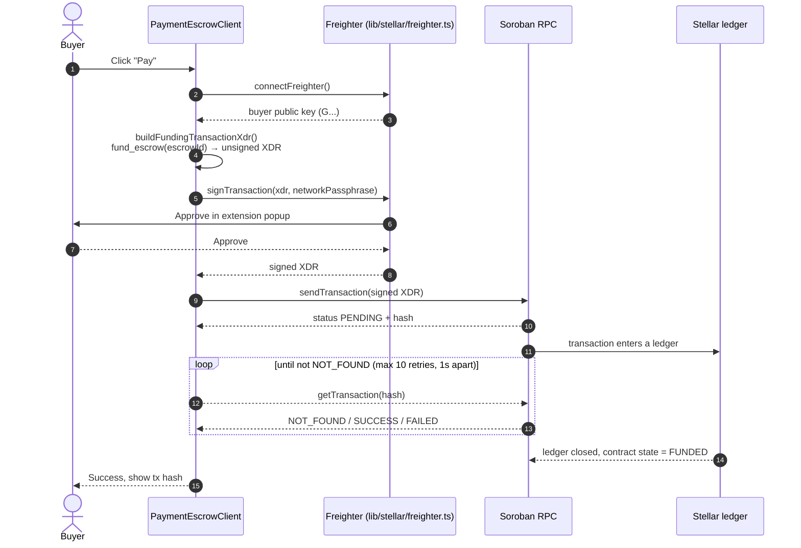

# Soroban Contract Integration

How the TrustLink frontend talks to the escrow smart contract: which pieces of code build, sign, submit and confirm a transaction, how confirmation polling and timeouts work, and where the current implementation stops short of a full Soroban flow.

This guide describes the code as it is, including the parts that are not finished. Those are collected in [Known gaps](#known-gaps) so a contributor does not assume a safeguard exists when it does not.

> **Scope.** This is the frontend side only. The Rust contract source and its storage layout belong to the backend/contract repository. For the mock flags and the four-stage payment pipeline see [PAYMENT_BOUNDARIES.md](PAYMENT_BOUNDARIES.md); for the overall layout see [ARCHITECTURE.md](../ARCHITECTURE.md).

---

## 1. Module map

| Module | Role |
|---|---|
| `lib/stellar/contract.ts` | Transaction building, signing, submission and confirmation for contract calls and classic payments |
| `lib/stellar/poll.ts` | `pollWithBackoff()` and `computeBackoffDelay()` — the generic backoff + jitter loop |
| `lib/stellar/freighter.ts` | The only module that talks to the Freighter extension (`connectFreighter`, `signTransaction`) |
| `lib/stellar/networks.ts` | Maps a network name (`TESTNET`, `PUBLIC`, `mainnet`) to a network passphrase |
| `components/payment/PaymentForm.tsx` | Exports `buildFundingTransactionXdr()` and `submitTransaction()`, the two helpers the live payment page uses |
| `app/pay/[escrowId]/PaymentEscrowClient.tsx` | The buyer payment page: orchestrates connect, build, sign and submit |
| `components/providers/NetworkProvider.tsx` | Supplies the RPC URL and passphrase for the selected network |

Defaults come from the environment: `NEXT_PUBLIC_SOROBAN_RPC_URL` (falls back to `https://soroban-testnet.stellar.org`), `NEXT_PUBLIC_CONTRACT_ID`, `NEXT_PUBLIC_STELLAR_NETWORK` and `NEXT_PUBLIC_STELLAR_NETWORK_PASSPHRASE`. See [ENV_VARS.md](ENV_VARS.md).

---

## 2. Escrow lifecycle: what is on-chain and what is not

An escrow moves through the states shown in the README state machine (`Pending → Funded → Shipped → Completed`, with `Disputed → Released | Refunded` and `Expired`). The frontend does not drive every transition through the contract. Today only funding goes through the wallet; the other steps go through the TrustLink REST API.

| Stage | Frontend entry point | Transport | Contract method the frontend can call |
|---|---|---|---|
| **Initialization** | `EscrowCreateForm` → `createEscrow()` in `lib/api/client.ts` | REST `POST /escrow` | none. The escrow record is created by the backend |
| **Funding** | `PaymentEscrowClient` (`/pay/[escrowId]`) | Freighter + Soroban RPC | `fund_escrow` |
| **Shipping** | `ShipTrackingModal` → `shipEscrow()` | REST `POST /escrows/:id/ship` | none |
| **Completion / Confirmation** | `ConfirmDeliveryButton` → `confirmDelivery()` from `lib/api` | REST `POST /escrows/:id/confirm` | `confirm_delivery` (helper exists, not wired to the UI) |
| **Dispute** | `app/dispute/[id]/DisputeForm.tsx` → `createDispute()` | REST `POST /escrows/:id/dispute` | `raise_dispute` (helper exists, not wired to the UI) |
| **Resolution** | `app/admin/disputes/[id]/DisputeDetailsClient.tsx` → `resolveDispute()` | REST `PATCH /disputes/:id/resolve` | none |

The three on-chain helpers in `lib/stellar/contract.ts` are `fundEscrow()`, `confirmDelivery()` and `raiseDispute()`. Each is a thin wrapper that calls the private `invokeSorobanContract()` with a fixed method name (`fund_escrow`, `confirm_delivery`, `raise_dispute`). Do not confuse `confirmDelivery()` in `lib/stellar/contract.ts` (on-chain) with the same-named REST function in `lib/api/client.ts`, which is the one the UI uses.

---

## 3. The two submission paths

There are two separate code paths that build and submit a Soroban invocation. They behave differently, so know which one you are touching.

### Path A — the live buyer payment page

`PaymentEscrowClient.handlePay()` is what runs when a buyer pays on `/pay/[escrowId]`:

1. `patchBuyerContact()` saves the optional email/phone.
2. `isFreighterInstalled()` then `connectFreighter()` and the wallet context's `connect()` obtain the buyer's public key.
3. `buildFundingTransactionXdr()` checks the contract ID starts with `C`, then calls `buildContractInvocation()` for method `fund_escrow` with the escrow ID as the single argument. This returns an **unsigned** transaction XDR.
4. `signTransaction(xdr, passphrase)` from `lib/stellar/freighter.ts` asks Freighter to sign it.
5. `submitTransaction(signedXdr, rpcUrl, passphrase)` calls `sendTransaction`, then polls `getTransaction(hash)` once a second, up to 10 more times, while the status is `NOT_FOUND`.

### Path B — the `lib/stellar/contract.ts` helpers

`fundEscrow()`, `confirmDelivery()` and `raiseDispute()` run `invokeSorobanContract()`:

1. Validate the contract ID (`isValidContractId()`, a real `StrKey` check, not just the `C` prefix), the method name and the source account.
2. `server.getAccount(sourceAccount)` loads the real account and sequence number from the RPC.
3. Build a transaction with `Operation.invokeContractFunction(...)`, `BASE_FEE`, and a 30-second `setTimeout`.
4. `signTransaction()` through Freighter, then `server.sendTransaction()`.
5. If the immediate response is `ERROR`, throw. Otherwise `pollWithBackoff()` polls `getTransaction(hash)` until `SUCCESS`, `FAILED`, or the 60-second budget runs out.
6. Resolve with `{ hash, resultXdr }` (the result as base64 XDR).

No page calls Path B today; it is exercised by `lib/stellar/contract.test.ts`. If you wire a new screen to the contract, prefer Path B: it fetches the real sequence number and uses the backoff poller.

`submitPayment()` in the same file is a third, separate helper: a classic XLM `payment` operation, not a contract call. It is the only function that honours `NEXT_PUBLIC_ESCROW_MOCK_PAYMENTS`.

---

## 4. End-to-end sequence

The diagram follows Path A, the one buyers actually use. Dashed arrows are the steps where the code polls.



`SUCCESS` here means a validator included the transaction in a closed ledger and the contract invocation did not trap. Signing alone proves nothing about settlement; see the four stages in [PAYMENT_BOUNDARIES.md](PAYMENT_BOUNDARIES.md).

---

## 5. Simulation: what it is and where it stands

On Soroban, a transaction that invokes a contract must declare the resources it will use (the ledger entries it reads and writes, CPU and memory budget, and any authorization entries) and must pay a matching resource fee. The standard way to obtain them is to **simulate** first: `server.simulateTransaction(tx)` runs the invocation against current ledger state without committing it and returns the footprint, the resource fee and the auth entries; `server.prepareTransaction(tx)` (or `rpc.assembleTransaction`) folds that result into the transaction before it is signed. Simulation also surfaces contract errors before the user is asked to sign anything.

**The frontend does not do this yet.** A search of the repository finds no call to `simulateTransaction`, `prepareTransaction` or `assembleTransaction`. Both paths build the invocation with `BASE_FEE` and no footprint, then sign and submit it. See [Known gaps](#known-gaps). If you add simulation, it belongs between building the transaction and calling `signTransaction()`, in both paths, and a simulation error should be shown to the buyer instead of opening the wallet.

---

## 6. Confirmation polling and timeouts

After `sendTransaction` returns `PENDING`, the result is only available on a later `getTransaction(hash)` call. The two paths handle the wait differently.

### Path B: `pollWithBackoff()` (`lib/stellar/poll.ts`)

```ts
pollWithBackoff<T>({
  check,          // async () => T | null | undefined — null/undefined means "not yet"
  timeoutMs,      // default 60_000
  initialDelayMs, // default 500
  maxDelayMs,     // default 5_000
  factor,         // default 1.5
  jitterRatio,    // default 0.2
  onTimeout,      // (attempts) => Error
})
```

- `check` runs first, with no initial wait. A non-nullish return value ends the loop. If `check` throws, the error propagates at once.
- Between attempts the delay is `computeBackoffDelay(attempt)`: `initialDelayMs × factor^(attempt−1)`, capped at `maxDelayMs`, then spread by up to ±`jitterRatio` using a random draw so many clients do not poll in lockstep. With the defaults the nominal delays are about 500, 750, 1125, 1688, 2531, 3797 and then 5000 ms, each varying by ±20%.
- The deadline is checked **after** each `check`. When elapsed time reaches `timeoutMs`, the loop throws `onTimeout(attempts)`, or a `PollTimeoutError` if none was given. A slow final `check` can therefore finish a little past 60 s.
- `sleep`, `random` and `now` are injectable, which is how `lib/stellar/poll.test.ts` runs without real timers.

`invokeSorobanContract()` supplies a `check` that returns the polled response on `SUCCESS`, throws on `FAILED`, and returns `null` otherwise (still `NOT_FOUND`).

### `TransactionConfirmationTimeoutError`

Defined in `lib/stellar/contract.ts`, thrown through `onTimeout`. It carries `hash` and `attempts`. **A timeout does not mean the transaction failed.** The transaction may still land after the client gives up, so the error keeps the hash. `invokeSorobanContract()` rethrows it as-is (all other errors are normalized by `toTxError()`), so callers can `instanceof`-check it and:

- show "still confirming" rather than "payment failed";
- link the buyer to `getStellarExpertTxUrl(error.hash)` (`lib/explorer.ts`) so they can check the ledger themselves;
- avoid prompting for a second payment, which could double-fund if the first one lands late.

### Path A: fixed polling in `submitTransaction()`

`submitTransaction()` does not use `pollWithBackoff()`. It calls `getTransaction` once, then up to 10 more times at a fixed 1-second interval while the status is `NOT_FOUND`, so it gives up after roughly 10 seconds. On timeout it throws a plain `Error("Timed out waiting for transaction to be included in a ledger")` with no hash attached. Ledgers close every few seconds, but 10 seconds is a tight budget and the caller cannot recover the hash from that error. See [Known gaps](#known-gaps).

---

## 7. Error handling

| Where | What happens |
|---|---|
| `sendTransaction` returns `ERROR` | The XDR result code name (for example `txBadSeq`, `txInsufficientFee`) is extracted by `transactionResultCode()` and thrown. Path A throws `Transaction failed: <code>` |
| `getTransaction` returns `FAILED` | Path B: `toTxError()`. Path A: an error whose message starts `TxFailed:` or `TxExpired:` when the result code matches, otherwise `Transaction failed: <code>` |
| `toTxError()` | Normalizes: a message containing `TxFailed`/`tx_failed` gets `name = "TxFailed"`, and `TxExpired`/`tx_expired` gets `name = "TxExpired"`. Anything else keeps its original message |
| Timeout (Path B) | `TransactionConfirmationTimeoutError` with `hash` and `attempts` |
| Timeout (Path A) | Plain `Error`, message above |
| Freighter not installed / signing refused | `signTransaction()` throws (`Freighter not installed`, or the extension's own message) and logs through `captureWalletError()` |
| Invalid inputs | `Invalid contract ID`, `Method name is required`, `Invalid source account public key` are thrown before any network call |

The payment UI maps these messages to user-facing text. In `PaymentForm.tsx` any message containing "reject" or "cancel" becomes "Transaction was rejected in wallet", `TxFailed` and `TxExpired` get their own prefixes via `parseContractError()`, and anything else is shown as-is. `parseContractError()` accepts a string, an `Error`, or an object with `message`, or `type: "ContractError"` and `details`.

---

## 8. Function reference

All in `lib/stellar/contract.ts` unless noted.

| Function | Signature (abridged) | Notes |
|---|---|---|
| `submitPayment` | `(amount, destination, options?) => Promise<string>` | Classic XLM payment. Validates the address and a positive amount of at most 7 decimals. Returns a fake hash only when mock payments are on |
| `fundEscrow` | `(contractId, args, sourceAccount, network = "TESTNET")` | Path B, method `fund_escrow` |
| `confirmDelivery` | `(contractId, args, sourceAccount, network = "TESTNET")` | Path B, method `confirm_delivery` |
| `raiseDispute` | `(contractId, args, sourceAccount, network = "TESTNET")` | Path B, method `raise_dispute` |
| `buildContractInvocation` | `(options: ContractCallOptions) => string` | Returns unsigned XDR. Uses a **placeholder account with sequence 0** (see gaps). Used by Path A |
| `buildContractDeployment` | `(wasmBuffer, sourceAccount, network) => string` | Unsigned WASM upload transaction, also with a placeholder account |
| `isValidContractId` | `(contractId) => boolean` | `StrKey.isValidContract` |
| `validateContractMethodCall` | `(method, args) => { valid, error? }` | Non-empty name of at most 256 characters, `args` is an array |
| `parseContractError` / `parseContractResult` / `isContractSuccess` | | Response-shape helpers |
| `isMockPaymentsEnabled` | `() => boolean` | True only when `NEXT_PUBLIC_ESCROW_MOCK_PAYMENTS === "true"` |
| `pollWithBackoff`, `computeBackoffDelay`, `PollTimeoutError` | `lib/stellar/poll.ts` | See section 6 |
| `getNetworkPassphrase` / `resolveNetworkPassphrase` | `lib/stellar/networks.ts` | Names to passphrases; Freighter needs the passphrase, never the name |

Return values for Path B are `ContractTransactionResult`: `{ hash: string; resultXdr: string }`. `ContractArg` accepts an `xdr.ScVal` or any native value that `nativeToScVal()` can convert.

---

## Known gaps

These are facts about the current code, listed so they can be picked up deliberately. None of them is changed by this document.

1. **No simulation or fee preparation.** Neither path calls `simulateTransaction` / `prepareTransaction`. Transactions carry `BASE_FEE` and no resource footprint. There is also no fee-bump handling anywhere in the codebase.
2. **Path A builds against a placeholder account.** `buildContractInvocation()` constructs `new Account(sourceAccount, "0")` and its source comment says real usage would fetch the account from the network. `submitTransaction()` forwards the signed XDR unchanged, so nothing replaces that sequence number with the buyer's real one.
3. **Path A polling is short and loses the hash on timeout.** About 10 seconds at a fixed interval, and a plain `Error` with no hash, unlike Path B.
4. **Path B is not used by any page.** `fundEscrow`, `confirmDelivery` and `raiseDispute` are only exercised by tests; the UI's delivery confirmation and dispute steps go through the REST API.
5. **`README.md` shows an out-of-date `fundEscrow` call.** The "Soroban Contract Calls" example passes an object (`escrowId`, `buyerAddress`, `amount`), but the real signature is `fundEscrow(contractId, args, sourceAccount, network)`. Treat this document and the source as authoritative.
